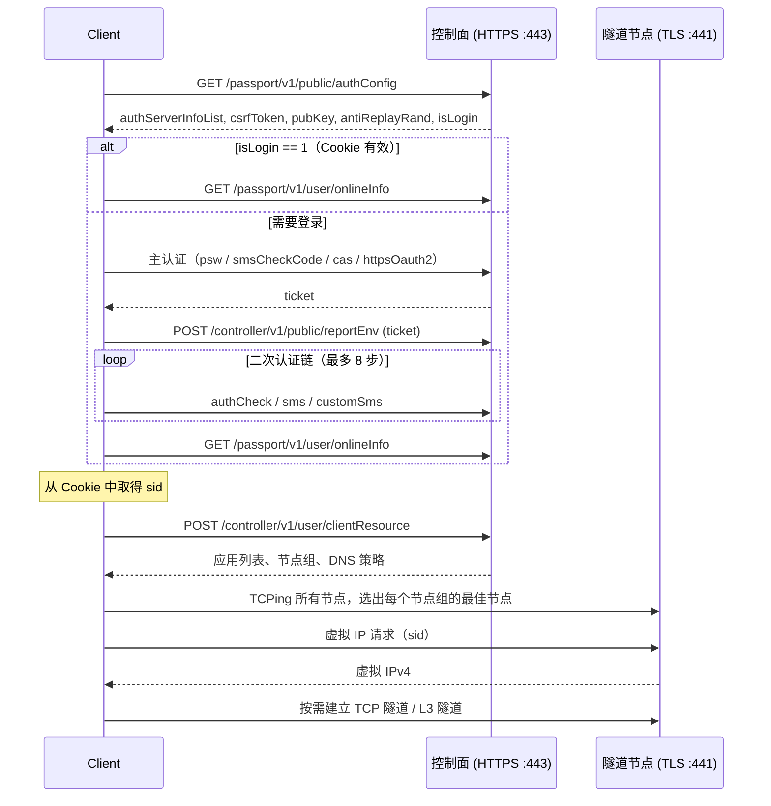

# aTrust 协议说明

本文档依据 `client/atrust/` 下的实现整理 aTrust（深信服零信任客户端）的控制面 HTTP API 与隧道线协议。协议为逆向所得，没有官方规范；字段语义凡属推断的均标注“推断”，未标注的内容与当前实现的收发字节一致。

- 所有多字节整数均为**大端序**。
- 字节序列用十六进制书写，`LEN(2)` 表示 2 字节大端长度，`XX` 表示可变字节。
- 代码引用基于当前仓库路径。

## 目录

1. [总体结构](#1-总体结构)
2. [客户端标识与密钥](#2-客户端标识与密钥)
3. [控制面：HTTPS API](#3-控制面https-api)
4. [隧道节点与选路](#4-隧道节点与选路)
5. [隧道线协议：公共部分](#5-隧道线协议公共部分)
6. [虚拟 IP 获取](#6-虚拟-ip-获取)
7. [TCP 隧道](#7-tcp-隧道)
8. [L3 隧道](#8-l3-隧道)
9. [请求签名 xRequestSig](#9-请求签名-xrequestsig)
10. [zju-connect 中的集成方式](#10-zju-connect-中的集成方式)
11. [实现注记与已知限制](#11-实现注记与已知限制)

---

## 1. 总体结构

aTrust 由两类服务端点组成：

| 端点 | 传输 | 默认端口 | 作用 |
| --- | --- | --- | --- |
| 控制面（SDP Controller / Passport） | HTTPS | 443（`-port`） | 认证、下发资源与策略、设备管理 |
| 隧道节点（Node） | TLS 上的私有二进制协议 | 441 | 分配虚拟 IP、TCP 隧道、L3（IP 包）隧道 |

客户端生命周期（`client/atrust/client.go` 中 `Client.Setup`）：



---

## 2. 客户端标识与密钥

| 名称 | 生成方式 | 生命周期 | 用途 |
| --- | --- | --- | --- |
| `DeviceID` | 16 字节随机数，32 位**小写** hex | 持久化到 client data file | `x-sdp-env`、`reportEnv`、隧道请求 |
| `ConnectionID` | `UPPER_HEX(MD5(DeviceID)) + "-" + UnixMicro()`，即 `<32 位大写 hex>-<微秒时间戳>` | 每次进程启动 | 隧道请求 |
| `SignKey` | 32 字节随机数，64 位**大写** hex；可用 `-sign-key` 指定 | 每次进程启动 | `xRequestSig` 的 HMAC 密钥（见第 9 节） |
| `SID` | 登录完成后 Cookie jar 中名为 `sid` 的 Cookie | 服务端会话 | 所有隧道请求的会话凭证 |
| `csrfToken` | `authConfig` 响应 `data.csrfToken`，为空时取 `data.security.csrfToken` | 每次 `authConfig` 刷新 | 请求头 `x-csrf-token` |
| `ticket` | 主认证响应（`data.ticket` 或 302 重定向中的 ticket） | 单次登录 | `reportEnv` |
| `rid` | `base64(host[:port])` | 会话 | 请求头 `x-sdp-rid` |
| `traceid` | 8 位随机小写 hex | 每个请求 | 请求头 `x-sdp-traceid` |

`host[:port]`：端口为 443 时省略端口，否则为 `host:port`。该字符串同时作为 HTTPS base URL 的 authority 和 Cookie 的 host。

### 2.1 Client data file

`-client-data-file` 保存登录状态，格式（`auth.ClientAuthData`）：

```json
{
  "cookies": [
    {"host": "vpn.zju.edu.cn", "scheme": "https", "name": "sid", "value": "<SID>"}
  ],
  "device_id": "<32 位小写 hex>"
}
```

启动时 Cookie 被注入 Cookie jar；若随后的 `authConfig` 返回 `isLogin == 1`，则跳过整个认证流程，`SID` 取自文件中 `host == baseHost && scheme == "https" && name == "sid"` 的条目。

### 2.2 跳过登录（调试用）

同时提供 `-sid`、`-device-id`、`-resource-file` 时，客户端不访问控制面：直接用给定 `SID`/`DeviceID`，从文件读取 `clientResource` 响应体，重新生成 `ConnectionID`，`SignKey` 取 `-sign-key` 或随机生成。

---

## 3. 控制面：HTTPS API

实现：`client/atrust/auth/`。

### 3.1 通用约定

- Base URL：`https://<host[:port]>`。TLS 证书**不校验**（`InsecureSkipVerify`）。
- HTTP 客户端带 Cookie jar，超时 20 s。
- 除 CAS/OAuth2 回调外，所有请求附加公共查询参数：

  ```
  clientType=SDPClient&platform=Linux&lang=en-US
  ```

- 请求头：

  | Header | 值 | 使用范围 |
  | --- | --- | --- |
  | `User-Agent` | `Mozilla/5.0 (X11; Linux x86_64) AppleWebKit/537.36 (KHTML, like Gecko) aTrustTray/2.4.10.50 Chrome/83.0.4103.94 Electron/9.0.2 Safari/537.36 aTrustTray-Linux-Plat-Ubuntu-x64 SPCClientType` | 全部 |
  | `x-csrf-token` | 最近一次 `authConfig` 得到的 `csrfToken`（首个请求为空） | 除 `checkCode` 外全部 |
  | `x-sdp-traceid` | 8 位随机 hex | 除 `checkCode` 外全部 |
  | `x-sdp-rid` | `base64(host[:port])` | 仅 `authConfig` |
  | `x-sdp-env` | `base64({"deviceId":"<DeviceID>"})` | `auth/psw`、`public/sendSms`、`auth/smsCheckCode` |
  | `Content-Type` | `application/json;charset=utf-8` | JSON 请求体 |

- 响应体统一为：

  ```json
  {"code": 0, "message": "", "data": { ... }}
  ```

  `code == 0` 表示成功。

### 3.2 `GET /passport/v1/public/authConfig`

获取可用认证方式、CSRF token、RSA 公钥与防重放随机数。

查询参数（在公共参数之外）：

| 参数 | 值 | 何时携带 |
| --- | --- | --- |
| `needTicket` | `1` | 登录开始、图形验证码刷新、`auth/sms` 步骤 |
| `mod` | `1` | CAS / OAuth2 回调之后、`auth/sms` 步骤 |

响应 `data`：

| 字段 | 类型 | 说明 |
| --- | --- | --- |
| `authServerInfoList[]` | array | 认证方式列表，元素见下表 |
| `isLogin` | int | `1` 表示当前 Cookie 对应的会话已登录 |
| `csrfToken` / `security.csrfToken` | string | CSRF token，前者优先 |
| `pubKey` | string | RSA 模数 N，hex |
| `pubKeyExp` | string | RSA 公钥指数 E，十进制字符串（通常 `65537`） |
| `antiReplayRand` | string | 密码加密用防重放随机串 |

`authServerInfoList[]` 元素：

| 字段 | 说明 |
| --- | --- |
| `loginDomain` | 登录域，例如 `Radius`、`local` |
| `authType` | `auth/psw`、`auth/cas`、`auth/httpsOauth2`、`auth/smsCheckCode` 等 |
| `authName` | 显示名 |
| `loginUrl` | 外部 IdP 登录地址（CAS / OAuth2 使用） |

客户端按 `(authType, loginDomain)` 精确匹配用户指定的认证方式；`-auth-info` 仅调用此接口并打印列表。

### 3.3 主认证

主认证的产物是 `ticket`，供 [`reportEnv`](#34-post-controllerv1publicreportenv) 使用。

#### 3.3.1 密码：`POST /passport/v1/auth/psw`

请求体：

```json
{
  "username": "<username>@<loginDomain>",
  "password": "<hex(RSA_PKCS1v15_Encrypt(pub, password + \"_\" + antiReplayRand))>",
  "rememberPwd": "0",
  "graphCheckCode": "<可选，见 3.3.2>"
}
```

- 公钥：`N = parseHex(pubKey)`，`E = atoi(pubKeyExp)`。
- 明文：`password + "_" + antiReplayRand`，PKCS#1 v1.5 填充，密文编码为小写 hex。
- 携带 `x-sdp-env`。

响应 `data`：

| 字段 | 说明 |
| --- | --- |
| `ticket` | 认证票据 |
| `graphCheckCodeEnable` | `1` 表示需要（重新）提交图形验证码 |

#### 3.3.2 图形验证码

当 `psw`、`sendSms` 或 `smsCheckCode` 返回 `graphCheckCodeEnable == 1` 时，客户端最多重试 5 次：

1. `GET /passport/v1/public/checkCode?rnd=<当前毫秒时间戳>`，`Accept: image/webp,image/apng,image/*,*/*;q=0.8`，响应体为验证码图片。
2. `GET /passport/v1/public/authConfig?needTicket=1`，刷新 `csrfToken`、`pubKey`、`antiReplayRand`（密码密文依赖 `antiReplayRand`，必须在重新提交前刷新）。
3. 获取用户输入，重新调用原接口并携带 `graphCheckCode`。

验证码为点选型。`graphCheckCode` 是一个 **JSON 字符串**，内容为：

```json
{"coordinates": [[x1, y1], [x2, y2], ...], "width": W, "height": H}
```

坐标为图片原始像素坐标，`width`/`height` 为图片原始尺寸。未指定 `-graph-code-file` 时，客户端在 `127.0.0.1` 随机端口启动临时 HTTP 服务（`/`、`/captcha.img`、`POST /submit`，表单字段 `code`），由浏览器点选后提交；输入会被规范化为上述格式，另接受 `[{"x":..,"y":..}]` 和 `[[x,y]]` 两种形式（此时宽高由图片解码得到）。指定 `-graph-code-file` 时图片写入文件，终端输入原样提交。

#### 3.3.3 短信验证码登录（`auth/smsCheckCode`）

1. `POST /passport/v1/public/sendSms`，携带 `x-sdp-env`：

   ```json
   {"phone": "<phone>@<loginDomain>", "graphCheckCode": ""}
   ```

   响应 `data`：`tips`、`interval`（string）、`graphCheckCodeEnable`。`phone` 格式为 `国家码-号码`，例如 `852-114514`。

2. `POST /passport/v1/auth/smsCheckCode`，携带 `x-sdp-env`：

   ```json
   {"code": "<短信验证码>", "phone": "<phone>@<loginDomain>", "graphCheckCode": "<可选>"}
   ```

   响应 `data`：`ticket`、`graphCheckCodeEnable`。

两步各自套用 3.3.2 的图形验证码重试逻辑。

#### 3.3.4 CAS（`auth/cas`）

1. 用户在浏览器访问 `authServerInfoList[].loginUrl`，IdP 登录成功后重定向到回调地址：

   ```
   https://<host>/passport/v1/auth/cas?sfDomain=<loginDomain>&ticket=<CAS ST>
   ```

   指定 `-cas-ticket` 时由客户端按上式拼接；否则由用户粘贴完整回调 URL。校验规则：scheme 为 `https`，host 等于 `host[:port]`，path 为 `/passport/v1/auth/cas`，`ticket` 非空（`sfDomain` 可缺省）。

2. 客户端 `GET` 该回调 URL，**禁止跟随重定向**，要求响应码为 `302`，`Location` 为：

   ```
   https://<host>/portal/shortcut.html?data=<URL 编码的 JSON>
   ```

   `data` 解码后为 `{"ticket": "<aTrust ticket>", ...}`，从中取得 `ticket`。`Location` 的 scheme/host/path 均被校验。

3. `GET /passport/v1/public/authConfig?mod=1`。

#### 3.3.5 OAuth2（`auth/httpsOauth2`）

与 CAS 相同，区别仅在回调地址：

```
https://<host>/passport/v1/auth/httpsOauth2?sfDomain=<loginDomain>&code=<OAuth2 code>&state=null
```

`-oauth2-code` 用于直接提供 `code`；交互模式下校验 path 为 `/passport/v1/auth/httpsOauth2` 且 `code` 非空。302 处理和后续 `authConfig?mod=1` 与 CAS 一致。

#### 3.3.6 空认证类型

`-auth-type ""` 时不执行主认证，仅依赖 client data file 中的 Cookie；`authConfig` 返回 `isLogin != 1` 时报错。

### 3.4 `POST /controller/v1/public/reportEnv`

主认证后必须调用，`ticket` 为空时客户端直接报错。

```json
{
  "ticket": "<ticket>",
  "deviceId": "<DeviceID>",
  "env": {
    "endpoint": {
      "device_id": "<DeviceID>",
      "device": {"type": "browser"}
    }
  }
}
```

响应 `code != 0` 为失败。

### 3.5 二次认证链

主认证和 `reportEnv` 之后，客户端从 `auth/authCheck` 开始执行认证链，每一步的响应决定下一步，`nextService` 为空时结束，最多 8 步。

#### 3.5.1 下一步的解析（`authStepFromData`）

各步骤响应中的 `data`：

```json
{
  "nextService": "auth/sms",
  "nextServiceList": [{"authId": "<id>", "authType": "auth/sms"}]
}
```

解析规则：

1. `service = nextService`。
2. 在 `nextServiceList` 中选取 `authType == service` 的项；没有则取第一项。
3. `authId` 取所选项的 `authId`；若 `service` 为空则取所选项的 `authType`。
4. `service` 为空而 `authId` 非空时视为 `auth/sms`（旧版网关只返回 `authId`）。
5. `auth/sms` 按 `authId` 是否为空分为两种模式（3.5.3）。

支持的 service：`auth/authCheck`、`auth/sms`、`auth/customSms`；其它值直接报错。

#### 3.5.2 `GET /passport/v1/auth/authCheck`

无请求体，响应 `data` 为上述结构，`code != 0` 为失败。

#### 3.5.3 短信二次认证（`auth/sms`）

两种网关行为：

| 步骤 | 带 `authId`（HITSZ 类网关） | 不带 `authId`（SARI 类网关） |
| --- | --- | --- |
| 1 | `GET authConfig?mod=1&needTicket=1` | `GET /passport/v1/public/phoneNumber` |
| 2 | `GET /passport/v1/public/phoneNumber?authId=<id>` | `GET /passport/v1/auth/sms?action=sendsms` |
| 3 | `GET /passport/v1/auth/sms?action=sendsms&isPrevEffect=0&taskId=&authId=<id>` | `GET authConfig?mod=1&needTicket=1` |
| 4 | `POST /passport/v1/auth/sms?action=checkcode`（JSON） | `POST /passport/v1/auth/sms?action=checkcode`（表单） |

- `phoneNumber` 响应 `data.phoneNumber` 可能是字符串或字符串数组，均为空时取 `data.maskIdentifierValue`；仅用于显示，失败不中断流程。
- `sendsms` 响应 `code` 为 `0` 或 `75500401` 均视为成功，`data.tips` 为提示文本。
- `checkcode` 请求体：

  带 `authId`，`Content-Type: application/json;charset=utf-8`：

  ```json
  {"authId": "<id>", "code": "<验证码>", "isPrevEffect": false, "skipSecondaryAuth": "0", "taskId": ""}
  ```

  不带 `authId`，`Content-Type: application/x-www-form-urlencoded`：

  ```
  code=<验证码>&skipSecondaryAuth=0
  ```

- 响应 `data` 为下一步（3.5.1）。
- `skipSecondaryAuth`：用户输入以 `$` 开头时发送 `"1"`，请求服务端在后续登录中跳过二次认证（推断：对应官方客户端的“信任此设备”选项）。

#### 3.5.4 自定义短信（`auth/customSms`）

1. `POST /passport/v1/auth/customSms?action=sendcustomsms`

   ```json
   {"isPrevEffect": "0", "taskId": ""}
   ```

   响应 `data.tips`。

2. `POST /passport/v1/auth/customSms?action=checkcustomcode`

   ```json
   {"isPrevEffect": false, "customCode": "<验证码>", "skipSecondaryAuth": "0", "taskId": ""}
   ```

   响应 `data` 为下一步。`skipSecondaryAuth` 规则同 3.5.3。

注意两个请求中 `isPrevEffect` 的类型不同（字符串 / 布尔），与实现一致。

### 3.6 `GET /passport/v1/user/onlineInfo`

响应 `data.username` 为服务端确认的用户名，用于 TCP 隧道请求的 `userName` 字段。登录完成后，客户端从 Cookie jar 读取 `https://<host[:port]>` 下的全部 Cookie，其中 `sid` 即 `SID`，全部 Cookie 写回 client data file。

### 3.7 `POST /controller/v1/user/clientResource`

请求体：

```json
{
  "resourceType": {
    "sdpPolicy": {},
    "appList": {},
    "favoriteAppList": {},
    "featureCenter": {},
    "uemSpace": {"params": {"action": "login"}}
  }
}
```

响应体原样保存（可用 `-resource-file` 复用），本实现只读取以下字段（Go `encoding/json` 按字段名大小写不敏感匹配，下文按驼峰书写）：

```json
{
  "data": {
    "appList": {
      "data": {
        "appInfo": [
          {
            "apps": [
              {
                "id": "<appId>",
                "nodeGroupId": "<nodeGroupId>",
                "addressList": [
                  {"protocol": "tcp", "port": "1-65535", "host": "10.0.0.0/8", "ip": []},
                  {"protocol": "all", "port": "443", "host": "*.example.edu.cn", "ip": ["10.1.2.3"]}
                ]
              }
            ]
          }
        ],
        "config": {
          "nodeGroupConf": {
            "majorNodeGroup": {"id": "<nodeGroupId>"},
            "nodeGroupList": [
              {
                "id": "<nodeGroupId>",
                "addressInfo": [
                  {"address": "{{sdpcHost}}", "type": "wan"},
                  {"address": "10.0.0.5:441", "type": "lan"}
                ]
              }
            ]
          }
        }
      }
    },
    "sdpPolicy": {
      "data": {
        "clientOption": {
          "dnsOption":   {"firstDNS": "10.10.0.21", "secondDNS": "..."},
          "dnsOptionV2": {"firstDNS": "...", "secondDNS": "..."}
        }
      }
    }
  }
}
```

#### 3.7.1 `addressList` 解析规则（`client/atrust/parse.go`）

只处理 `protocol` 为 `tcp`、`udp`、`all` 的条目。

`port`：

- `"N"` → `[N, N]`
- `"N-M"` → `[N, M]`
- 其它格式跳过该条目。

`host` 依次尝试：

| 形式 | 示例 | 结果 |
| --- | --- | --- |
| IPv4 地址 | `10.1.2.3` | IP 资源 `[ip, ip]` |
| IPv4 CIDR | `10.13.0.0/16` | IP 资源 `[网络地址, 广播地址]` |
| IPv4 区间 | `10.0.0.1-10.0.0.200` | IP 资源 `[起, 止]` |
| 其它 | `*.zju.edu.cn` | 域名资源，key 为去掉 `*` 的字符串（`.zju.edu.cn`），按后缀匹配 |

IPv6 形式一律跳过。每条 IP / 域名资源都记录 `(PortMin, PortMax, Protocol, AppID, NodeGroupID)`，后续用于确定隧道请求的 `appId` 与节点组。

`ip[]`：仅对域名资源生效，取第一个 IPv4 作为该域名的静态 DNS 记录（key 为原始 `host`，含 `*`），并将该 IP 加入路由 IP 集合。

#### 3.7.2 节点组

- `majorNodeGroup.id`：主节点组，用于虚拟 IP 请求和节点组缺失时的回退。
- `nodeGroupList[].addressInfo[]`：
  - `address == "{{sdpcHost}}"` 替换为 `-server` 地址；
  - 不含 `:` 的地址追加默认端口 `:441`；
  - `type`（大小写不敏感）为 `wan` 或 `lan`，其它类型忽略。
- 节点 IP 从路由 IP 集合中移除，防止到节点的流量被路由进隧道。

#### 3.7.3 DNS

`sdpPolicy.data.clientOption.dnsOption.firstDNS` 非空时作为远端 DNS，否则使用 `dnsOptionV2.firstDNS`。`-zju-dns-server auto`（默认）时生效。

### 3.8 设备信任

`-trust-device` / `-untrust-device` 使用 client data file 中的 Cookie 恢复会话后调用：

1. `GET /passport/v1/security/queryDevice?status=trust` → `data.selfId`、`data.deviceTrusted`（bool）。
2. `POST /passport/v1/security/trustDevice` 或 `POST /passport/v1/security/untrustDevice`：

   ```json
   {"idList": ["<selfId>"]}
   ```

### 3.9 接口汇总

| 方法 | 路径 | 用途 |
| --- | --- | --- |
| GET | `/passport/v1/public/authConfig` | 认证配置、CSRF、公钥 |
| GET | `/passport/v1/public/checkCode` | 图形验证码图片 |
| POST | `/passport/v1/auth/psw` | 密码认证 |
| POST | `/passport/v1/public/sendSms` | 短信登录：发送验证码 |
| POST | `/passport/v1/auth/smsCheckCode` | 短信登录：校验验证码 |
| GET | `/passport/v1/auth/cas` | CAS 回调 |
| GET | `/passport/v1/auth/httpsOauth2` | OAuth2 回调 |
| POST | `/controller/v1/public/reportEnv` | 上报终端环境 |
| GET | `/passport/v1/auth/authCheck` | 查询下一认证步骤 |
| GET | `/passport/v1/public/phoneNumber` | 查询绑定手机号（掩码） |
| GET / POST | `/passport/v1/auth/sms` | 二次认证短信：`action=sendsms` / `action=checkcode` |
| POST | `/passport/v1/auth/customSms` | 自定义短信：`action=sendcustomsms` / `action=checkcustomcode` |
| GET | `/passport/v1/user/onlineInfo` | 当前登录用户 |
| POST | `/controller/v1/user/clientResource` | 资源与策略 |
| GET | `/passport/v1/security/queryDevice` | 查询设备信任状态 |
| POST | `/passport/v1/security/trustDevice` | 信任设备 |
| POST | `/passport/v1/security/untrustDevice` | 取消信任设备 |

---

## 4. 隧道节点与选路

实现：`client/atrust/node.go`。

### 4.1 最佳节点选择

对每个节点组：

1. 对组内所有 **WAN** 节点并发执行 TCPing：每节点 3 次，间隔 0.5 s，超时 1 s。
2. 只有 3 次全部成功的节点参与比较，取平均延迟最小者。
3. 对没有可达 WAN 节点、且有 LAN 节点的组，以同样方式探测 LAN 节点。
4. 所有节点都不可达的组不出现在结果中。

结果 `BestNodes: nodeGroupID → "host:port"`。`-update-best-nodes-interval`（默认 300 s，0 为关闭）控制周期性重测。

### 4.2 连接时的节点选择

| 场景 | 选择 |
| --- | --- |
| 虚拟 IP 请求 | `BestNodes[majorNodeGroup]`，为空则任取一个 |
| TCP 隧道 / L3 隧道 | `BestNodes[资源的 nodeGroupId]`，为空则 `BestNodes[majorNodeGroup]` |

重测只影响之后新建的连接；已建立的 L3 隧道连接保持原节点直到断开。

---

## 5. 隧道线协议：公共部分

所有隧道连接都是到节点 `host:port` 的 TLS 连接（证书不校验），握手阶段借用 SOCKS5（RFC 1928）的消息结构，但使用私有的 method、command 和子协商格式。

### 5.1 握手结构

客户端一次性发送三段数据（不等待服务端响应）：

```
+-----+----------+--------+     +------+------+--------+--------+     +-----+-----+-----+------+----------+----------+
| VER | NMETHODS | METHOD |     | SVER | TYPE | LEN(2) |  JSON  |     | VER | CMD | RSV | ATYP | DST.ADDR | DST.PORT |
+-----+----------+--------+     +------+------+--------+--------+     +-----+-----+-----+------+----------+----------+
|  05 |    01    |   XX   |     |  53  |  XX  |        |        |     |  05 |  XX |  XX |  XX  |   ...    |    2     |
+-----+----------+--------+     +------+------+--------+--------+     +-----+-----+-----+------+----------+----------+
   ① 方法协商                          ② 认证子协商                                ③ 请求
```

| 用途 | ① METHOD | ② TYPE | ③ CMD | ③ RSV |
| --- | --- | --- | --- | --- |
| 虚拟 IP / L3 隧道 | `D0` | `00` | `04` | `00` |
| TCP 隧道 | `81` | `03` | `01`（CONNECT） | `01` |

`SVER = 0x53`（ASCII `S`）。`METHOD`、`TYPE`、`CMD = 04` 均为私有值；`TYPE` 的语义为推断（区分认证载荷格式）。

### 5.2 服务端控制消息 `53 00`

服务端在握手阶段和之后都可能发送：

```
53 STATUS LEN(2) PAYLOAD
```

`STATUS = 00` 表示成功，`PAYLOAD` 通常为 JSON，成功时包含 `OK`。各连接类型对它的处理见后文。

---

## 6. 虚拟 IP 获取

实现：`client/atrust/ip.go` 中 `getIP`。连接 `BestNodes[majorNodeGroup]`。

客户端发送：

```
05 01 D0
53 00 00 53 {"sid":"<SID>"}
05 04 00 01 00 00 00 00 00 00
```

注意：此处 `LEN` 被硬编码为 `0x0053`（83），即假定 `{"sid":"<SID>"}` 恰为 83 字节（SID 长 73 字符）。L3 隧道握手中的同一消息按实际长度计算（见 8.1）。

服务端响应：

```
05 D0                         方法选择（客户端忽略）
53 00 LEN(2) <JSON>           认证结果，JSON 须包含 "OK"
05 00 00 01 A B C D [P P]     请求结果：REP=00, ATYP=01, 虚拟 IPv4 = A.B.C.D
```

客户端读取 `05 00` 后的 6 字节（`RSV ATYP` + 4 字节 IPv4），取得虚拟 IP 后关闭连接；尾随 2 字节（推断为 BND.PORT）不读取。每次读取超时 10 s。

虚拟 IP 用作 TUN / gVisor 协议栈的本地地址，也是 L3 隧道中发出 IP 包的源地址。

---

## 7. TCP 隧道

实现：`client/atrust/tcptunnel.go` 中 `Client.DialTCP`。每条 TCP 连接对应一条独立的 TLS 连接。`-tcp-tunnel-mode` 下所有 TCP 流量走此路径。

### 7.1 资源匹配

- 若解析阶段命中了域名资源（context 中有 `DomainResource`），使用其 `AppID`/`NodeGroupID`，目的地址以域名形式发送。
- 否则遍历 IP 资源，匹配目的 IP 区间、端口区间、`protocol ∈ {tcp, all}`，取**最后一个**命中项。
- 均未命中时 `appId`、`nodeGroupId` 为空串，仍会发起连接（节点回退到主节点组）。

### 7.2 客户端握手

```
05 01 81
53 03 LEN(2) <JSON 认证载荷>
05 01 01 01 <IPv4(4)> <PORT(2)>                  # 目的为 IP
05 01 01 03 <DLEN(1)> <DOMAIN(DLEN)> <PORT(2)>   # 目的为域名（DLEN ≤ 255）
```

目的地址只支持 IPv4（`ATYP=01`）与域名（`ATYP=03`）。

认证载荷（字段顺序与实现一致，签名覆盖该字节串）：

```json
{
  "sid": "<SID>",
  "appId": "<appId>",
  "url": "tcp://<destAddr>",
  "deviceId": "<DeviceID>",
  "connectionId": "<ConnectionID>",
  "procHash": "<procHash>",
  "userName": "<onlineInfo.username>",
  "rcAppliedInfo": 0,
  "lang": "en-US",
  "destAddr": "<destAddr>",
  "env": {
    "application": {
      "runtime": {
        "process": {
          "name": "<procName>",
          "digital_signature": "TrustAppClosed",
          "platform": "Linux",
          "fingerprint": "<procHash>",
          "description": "TrustAppClosed",
          "path": "<procPath>",
          "version": "TrustAppClosed",
          "security_env": "normal"
        },
        "process_trusted": "TRUSTED"
      }
    }
  },
  "xRequestSig": "<签名>"
}
```

| 字段 | 取值 |
| --- | --- |
| `destAddr` | 命中域名资源时为 `<domain>:<port>`，否则为 `<ip>:<port>` |
| `procName` / `procPath` | 目的端口 22：`ssh` / `/usr/bin/ssh`；其它：`google-chrome-stable` / `/usr/bin/google-chrome-stable` |
| `procHash` | `UPPER_HEX(SHA256(procPath))` |
| `xRequestSig` | 见第 9 节 |

`env.application.runtime.process` 描述发起连接的本地进程，服务端据此执行进程级访问策略（推断）；本实现使用固定值伪装为受信任进程。

### 7.3 服务端响应与连接确认

```
S→C  05 81                    方法选择，忽略
S→C  53 00 LEN(2) <PAYLOAD>   PAYLOAD 须包含 "OK"，否则失败
C→S  01 00 00 00              连接探测（零长度数据帧）
S→C  05 REP                   连接结果（2 字节）
```

`REP` 与 SOCKS5 一致：

| REP | 含义 |
| --- | --- |
| `00` | 成功 |
| `01` | 服务端一般性故障 |
| `02` | 规则不允许连接 |
| `03` | 网络不可达 |
| `04` | 主机不可达 |
| `05` | 连接被拒绝 |
| `06` | TTL 过期 |
| `07` | 不支持的命令 |
| `08` | 不支持的地址类型 |

`-skip-tcp-tunnel-wait` 时跳过本节全部读取与探测，直接进入数据阶段，由数据阶段的读取逻辑消化 `05 81` 与 `53 00` 消息。等待期间 context 取消会关闭底层连接。

### 7.4 数据阶段帧格式

| 帧 | 字节 | 方向 | 处理 |
| --- | --- | --- | --- |
| 数据 | `01 00 LEN(2) DATA` | 双向 | `LEN ≤ 0xFFFF`；读取时一次返回一帧，超出调用方缓冲区的部分缓存 |
| 关闭 | `01 01 00 00` | C→S | `Close()` 时发送，然后关闭 TLS |
| 关闭 | `01 01 30 30` | S→C | `30 30` 为 ASCII `"00"`；客户端关闭连接并返回错误 |
| 控制消息 | `53 00 LEN(2) PAYLOAD` | S→C | 不含 `OK` 时关闭连接；含 `invalid SID` 时进程 panic |
| 其它 2 字节头 | — | S→C | 忽略，继续读取 |

---

## 8. L3 隧道

实现：`client/atrust/l3tunnel*.go`。以 IP 包为单位转发 TCP / UDP / ICMP 流量，供 gVisor（默认）和 TUN 模式使用。

### 8.1 连接建立与隧道认证

每个节点组维护一条 TLS 连接，在该组的首个包到达时惰性建立（10 s 超时）。

客户端发送：

```
05 01 D0
53 00 LEN(2) {"sid":"<SID>"}
05 04 00 01 00 00 00 00 00 00
```

与第 6 节相同，但 `LEN` 按实际 JSON 长度计算。

服务端响应，客户端严格按顺序读取：

```
05 D0                        方法选择；不是 05 D0 则失败
53 STATUS LEN(2) <JSON>      STATUS 须为 00
05 00 00 ATYP <VIP 数据>     虚拟 IP
```

`<JSON>` 结构：

```json
{"code": 0, "message": "...", "data": {"deviceId": "<DeviceID>"}}
```

`code != 0` 为失败。

`ATYP` 与 `<VIP 数据>` 长度：

| ATYP | 长度 | 内容 |
| --- | --- | --- |
| `01` | 6 | IPv4(4) + 2 字节 |
| `04` | 18 | IPv6(16) + 2 字节 |
| `05` | 22 | IPv4(4) + IPv6(16) + 2 字节（双栈，私有值） |
| 其它 | 4 | — |

VIP 头首字节不是 `05` 时不读取 VIP 数据。解析出的 VIP 仅被记录，本实现不使用。

握手完成后连接进入帧模式，并启动读循环与心跳循环。

### 8.2 帧格式

帧头为 `05 CMD`，响应命令字 = 请求命令字 `| 0x80`：

| CMD | 名称 | 方向 | 格式 |
| --- | --- | --- | --- |
| `13` | 流认证请求 | C→S | `05 13 LEN(2) <JSON>` |
| `93` | 流认证响应 | S→C | `05 93 STATUS LEN(2) <JSON>` |
| `14` | 数据 | C→S | `05 14 TLEN(1) TOKEN(TLEN) 00 00 N(1) { PLEN(2) PACKET(PLEN) } × N` |
| `94` | 数据 | S→C | 两种格式，见 8.5 |
| `15` | 心跳请求 | C→S | `05 15 00 00` |
| `95` | 心跳响应 | S→C | `05 95 LEN(2) PAYLOAD` |
| `16` | 二次 VIP 请求 | C→S | `05 16`（当前未发送） |
| `96` | 二次 VIP 响应 | S→C | `05 96 STATUS LEN(2) <JSON>` |
| 其它 | — | S→C | `05 CMD LEN(2) PAYLOAD`，忽略 |

此外服务端可随时发送 `53 00 LEN(2) PAYLOAD` 控制消息，客户端读出后丢弃。其它首字节视为协议错误并关闭连接。

### 8.3 流（conntrack）与流认证

服务端要求每条流在传输数据前单独认证，认证成功后返回 `connectToken`，此后该流的数据帧都携带这个 token。

**流标识**（每条 L3 连接内独立维护）：

```
key = "<atype>:<srcIP>:<srcPort>-<dstIP>:<dstPort>"
```

`atype` 恒为 `4`；ICMP 的端口为 0。键中不含协议号。

每个新流分配 `conntrackHash`：连接内从 1 开始递增的 uint64。

**流认证请求**（`05 13`）的 JSON，字段顺序与实现一致：

```json
{
  "sid": "<SID>",
  "appId": "<appId>",
  "url": "tcp:10.10.0.21:53",
  "deviceId": "<DeviceID>",
  "connectionId": "<ConnectionID>",
  "env": {
    "application": {
      "runtime": {
        "process": {
          "name": "zju-connect",
          "digital_signature": "TrustAppClosed",
          "platform": "Linux",
          "fingerprint": "<UPPER_HEX(SHA256(\"/usr/bin/zju-connect\"))>",
          "description": "TrustAppClosed",
          "path": "/usr/bin/zju-connect",
          "version": "TrustAppClosed",
          "security_env": "normal"
        },
        "process_trusted": "TRUSTED"
      }
    }
  },
  "conntrackHash": 1,
  "lang": "zh-CN",
  "ip": {
    "atype": 2048,
    "protocol": 6,
    "destAddr": "10.10.0.21",
    "destPort": 53,
    "srcAddr": "<VIP>",
    "srcPort": 51234
  },
  "procHash": "<同 fingerprint>",
  "xRequestSig": "<签名>"
}
```

| 字段 | 说明 |
| --- | --- |
| `url` | `<proto>:<dstIP>:<dstPort>`，`proto` 为 `tcp`/`udp`/`icmp`/`icmp6`/`ip`；注意没有 `//` |
| `conntrackHash` | 客户端分配的流 ID，服务端在响应中原样返回，用于关联 |
| `lang` | 依次取环境变量 `ZJU_CONNECT_LANG`、`LC_ALL`、`LC_MESSAGES`、`LANG`，去掉 `.` 后缀、`_` 换成 `-` 并规范大小写（`zh_CN.UTF-8` → `zh-CN`）；均为空时为 `en-US` |
| `ip.atype` | 以太网类型：IPv4 `0x0800`（2048），IPv6 `0x86DD` |
| `ip.protocol` | IP 协议号：TCP 6，UDP 17，ICMP 1 |
| `platform` | `runtime.GOOS` 首字母大写，`darwin` 写作 `macOS` |
| `domain` | 结构中存在（`omitempty`），当前不填 |

**流认证响应**（`05 93 STATUS LEN(2) JSON`）：

```json
{
  "code": 0,
  "message": "",
  "data": {
    "vipType": "...",
    "vip4Type": "...",
    "vip6Type": "...",
    "conntrackHash": 1,
    "connectToken": "<token>",
    "token": "<token，旧字段>",
    "ip": { ... }
  }
}
```

处理规则：

1. 按 `data.conntrackHash` 找到对应流；`conntrackHash == 0` 或 JSON 无法解析时无法关联，响应被丢弃。
2. `STATUS != 0` 或 `code != 0` → 该流认证失败。
3. token 取 `connectToken`（去空白），为空则取 `token`；两者均空视为失败。
4. token 长度必须 ≤ 255（数据帧中 `TLEN` 为 1 字节）。

**时序与并发**：

- 同一流的首个包触发认证请求，并发到达的同流包等待同一个结果。
- 等待上限 8 s，超时返回 `errL3TunnelAuthTimeout`。
- 认证结果（成功或失败）在该 L3 连接内永久缓存；流表不做老化。

### 8.4 客户端数据帧（`05 14`）

```
05 14
TLEN(1)  TOKEN(TLEN)       该流的 connectToken
00 00                      保留
N(1)                       包数量，本实现恒为 1
PLEN(2)  PACKET(PLEN)      完整 IPv4 包（含 IP 头）
```

该帧没有整体长度字段，接收方依次解析 `TLEN`、`N`、`PLEN`。

### 8.5 服务端数据帧（`05 94`）

服务端使用两种格式，客户端读取 `05 94` 后 peek 2 字节，按大端 uint16 判定：

| 条件 | 模式 | 格式 |
| --- | --- | --- |
| `0 < v ≤ 4096` | `len` | `05 94 LEN(2) PACKET(LEN)`，单个 IP 包 |
| 其它 | `token` | `05 94 TLEN(1) TOKEN(TLEN) 00 00 N(1) { PLEN(2) PACKET(PLEN) } × N`，与 8.4 相同 |

`token` 模式中 `PLEN == 0` 的条目被跳过。

判定边界：`token` 模式下 peek 值为 `TLEN × 256 + TOKEN[0]`（`TLEN = 0` 时第二字节是保留字节 `00`，值为 0，判定正确）。当 `1 ≤ TLEN ≤ 15` 时会被误判为 `len` 模式；`len` 模式下包长超过 4096 会被误判为 `token` 模式。实际 MTU 为 1400，服务端返回的 token 为空或远长于 16 字节时不受影响。

收到的 IP 包进入共享的接收队列（容量 4096），由 `L3Conn.Read` 每次返回一个包。

### 8.6 心跳

每 25 s 发送 `05 15 00 00`。`05 95` 响应只记录日志；未收到响应不触发重连。

### 8.7 二次 VIP

`05 16` 请求在代码中被注释掉（发送时机未知）。若收到 `05 96` 且 `STATUS == 0`，客户端递归遍历 JSON 中所有字符串值，能解析为 IP 的都作为 VIP 记录，本实现不使用。

### 8.8 发送路径与错误处理

`L3Conn.Write(ipPacket)` → `processIPV4`：

1. 只接受 TCP / UDP / ICMP；其它协议返回 `ErrResourceNotFound`。
2. 按顺序遍历 IP 资源，取**第一个**满足以下条件的资源：目的 IP ∈ `[IPMin, IPMax]`，`protocol` 相同或为 `all`，TCP/UDP 目的端口 ∈ `[PortMin, PortMax]`（ICMP 不比较端口）。
3. 无命中返回 `ErrResourceNotFound`，协议栈丢弃该包并记录日志。
4. 命中后用资源的 `nodeGroupId` 取（或建立）L3 连接，执行 8.3 的流认证，然后发送 8.4 的数据帧。

重试策略（`writePacket`）：

| 错误 | 处理 |
| --- | --- |
| 连接已关闭（`net.ErrClosed` / `use of closed network connection`） | 从连接表移除该连接，重建后重发，最多 5 次 |
| 流认证超时 | 移除连接、重建并重发 1 次；仍超时则移除连接并**静默丢包**（返回 nil，由上层 TCP 重传） |
| 其它 | 返回给协议栈 |

读循环遇到任何读错误都会关闭连接，并将其从连接表移除；下一个包会触发新连接的建立，流表随之重置，所有流需重新认证。

---

## 9. 请求签名 xRequestSig

TCP 隧道认证载荷和 L3 流认证请求都携带 `xRequestSig`：

```
unsigned = 将 xRequestSig 置为 "" 后的 JSON 字节串
xRequestSig = UPPER_HEX( HMAC-SHA256( key = hex_decode(SignKey), msg = unsigned ) )
```

- L3：`json.Marshal` 结构体（字段顺序固定）→ 计算签名 → 填入后再次 `json.Marshal`。
- TCP：按固定模板 `fmt.Sprintf` 生成以 `"xRequestSig":""}` 结尾的字符串 → 计算签名 → 将末尾 3 个字符 `""}` 替换为 `"<sig>"}`。

`SignKey` 为客户端本地随机生成，本实现未通过任何接口将其上报给服务端。

---

## 10. zju-connect 中的集成方式

| 选项 | 协议栈 | 使用的隧道 | 说明 |
| --- | --- | --- | --- |
| 默认 | gVisor 用户态协议栈 | L3 隧道 | TCP / UDP / ICMP，MTU 1400 |
| `-tun-mode` | TUN 设备 | L3 隧道 | 同上；`-add-route` 时按资源 IP 集合添加路由 |
| `-tcp-tunnel-mode` | 无（直接拨号） | TCP 隧道 | 仅 TCP，UDP 不可用 |

其它行为：

- `-protocol atrust` 时强制 `proxy_all = false`，只有命中资源的目的地址走隧道。
- `-server` 为默认值 `rvpn.zju.edu.cn` 时自动改为 `vpn.zju.edu.cn`。
- 域名资源由 resolver 按后缀匹配，命中后通过 context 传递 `DomainResource`，TCP 隧道据此以域名形式发送目的地址。
- 到控制面与节点的连接经 `internal/underlay` 拨号：`-bind-interface` 指定出口网卡，`-auto-detect-interface` 自动探测；取得虚拟 IP 后，持有该 IP 的网卡（TUN）被排除在候选出口之外，避免隧道流量回环。
- 相关参数：`-protocol atrust`、`-auth-type`、`-login-domain`、`-phone`、`-cas-ticket`、`-oauth2-code`、`-graph-code-file`、`-client-data-file`、`-auth-info`、`-trust-device`、`-untrust-device`、`-update-best-nodes-interval`、`-skip-tcp-tunnel-wait`、`-sid`、`-device-id`、`-sign-key`、`-resource-file`。

---

## 11. 实现注记与已知限制

1. **TLS 不校验证书**：控制面 HTTPS 与所有隧道连接均为 `InsecureSkipVerify: true`。
2. **虚拟 IP 请求长度硬编码**：第 6 节中子协商长度固定为 `0x0053`，只对 73 字符的 SID 正确；L3 握手使用 `wrapAuthReqData` 计算实际长度。
3. **仅支持 IPv4**：IPv6 资源被跳过，TCP 隧道拒绝 IPv6 目的地址，L3 流的 `atype` 恒为 4。
4. **流表不老化**：L3 连接内的 conntrack 条目只增不减，认证失败的结果也被缓存，直到该连接被重建。
5. **资源匹配顺序不一致**：TCP 隧道取最后一个命中的 IP 资源，L3 隧道取第一个。
6. **L3 只按 IP 资源匹配**：`processIPV4` 不查询域名资源；域名资源的 `ip[]` 只进入路由集合和静态 DNS，不生成 IP 资源条目。
7. **进程信息为固定伪造值**：TCP 隧道使用 `google-chrome-stable` / `ssh`，L3 使用 `zju-connect`，`process_trusted` 固定为 `TRUSTED`。
8. **`05 94` 模式判定为启发式**，边界见 8.5。
9. **二次 VIP 请求未启用**，VIP 信息不参与路由。
10. **TCP 隧道收到含 `invalid SID` 的控制消息时进程 panic**，需要重新登录。
